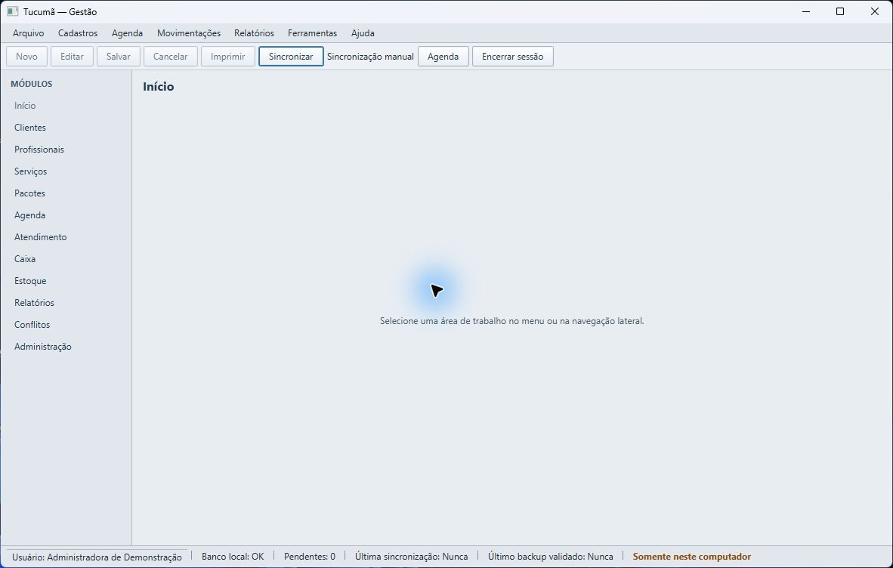
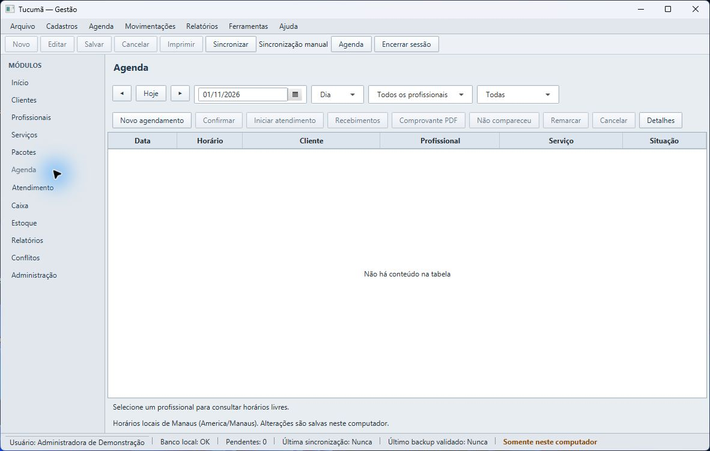
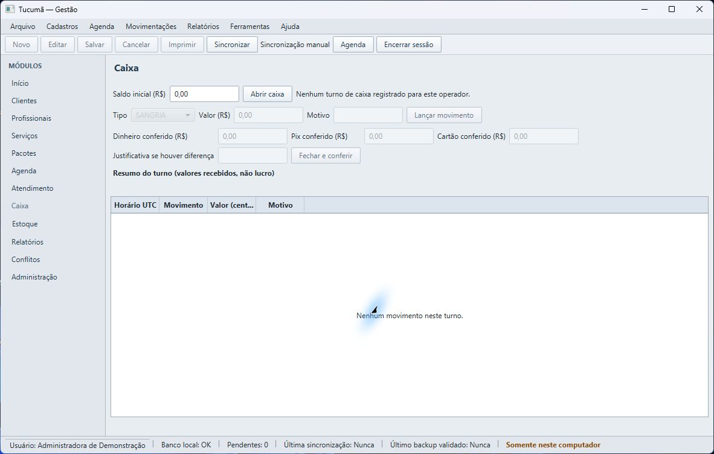
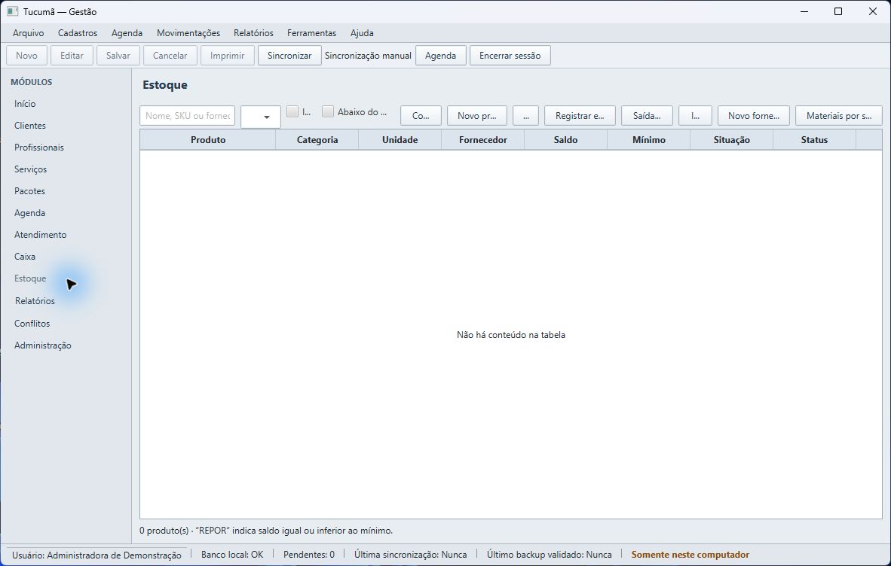
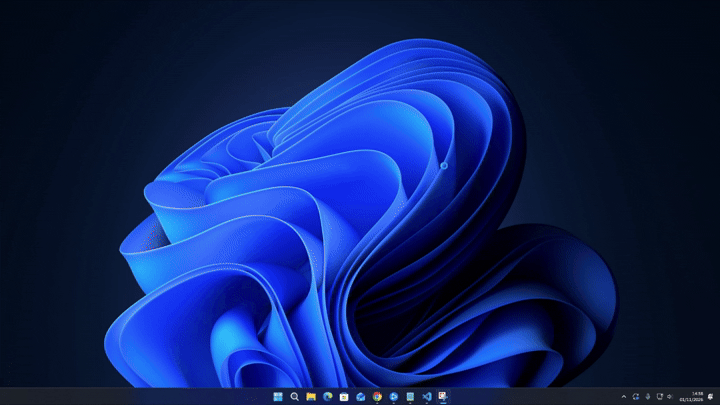

# Espaço Tucumã

Aplicação de gestão Windows-first e offline-first para beleza e estética. A operação diária fica no computador local; a sincronização com o serviço remoto é iniciada manualmente.

> Este é um projeto fictício de portfólio que simula uma encomenda freelancer. O estabelecimento e os registros das demonstrações são sintéticos. Não representam contrato, faturamento, depoimentos ou implantação real em cliente.

## Aplicação em execução

As capturas mostram a interface desktop em telas reais do aplicativo. Os cadastros e movimentos exibidos são vazios ou sintéticos.

<p align="center">
  
  
</p>
<p align="center">
  
  
</p>

### Auditoria automatizada

O GIF abaixo mostra o teste de auditoria sendo executado.

<p align="center">
  
</p>

## Módulos

| Módulo | Responsabilidade |
| --- | --- |
| `desktop-app` | Aplicação JavaFX e banco operacional SQLite local. |
| `sync-contract` | Contrato REST e DTOs compartilhados. |
| `sync-service` | Serviço Spring Boot para sincronização e snapshots remotos. |

## Estrutura do projeto

```text
.
├── .github/                 Integração contínua
├── .prompts/                Fila e tarefas do pipeline
├── deploy/                  Configuração de implantação
├── desktop-app/             Aplicação Windows JavaFX + SQLite
├── docs/
│   ├── arquitetura/         Arquitetura e contrato OpenAPI
│   ├── imagens/             Capturas e demonstrações visuais
│   ├── operacao/            Instalação, uso, segurança e recuperação
│   ├── portfolio/           Roteiro de demonstração
│   ├── qualidade/           Cobertura, validação e auditoria
│   └── ESPECIFICACAO_ESPACO_TUCUMA.md  Fonte normativa do produto
├── scripts/                 Build e validações locais
├── sync-contract/           Contratos e modelos compartilhados
├── sync-service/            Serviço remoto restrito
└── pom.xml                  Build Maven multimódulo
```

## Documentação

- **Produto:** [Especificação](docs/ESPECIFICACAO_ESPACO_TUCUMA.md) — fonte normativa.
- **Arquitetura:** [Decisões e diagramas](docs/arquitetura/ARQUITETURA.md), [contrato OpenAPI](docs/arquitetura/openapi-sync-v1.yaml).
- **Operação:** [Manual operacional](docs/operacao/MANUAL_OPERACIONAL.md), [instalação Windows](docs/operacao/INSTALACAO_WINDOWS.md), [backup e recuperação](docs/operacao/RECUPERACAO_E_BACKUP.md), [segurança do serviço remoto](docs/operacao/SEGURANCA_SERVICO_REMOTO.md) e [ambiente de demonstração](docs/operacao/AMBIENTE_DEMONSTRACAO.md).
- **Qualidade:** [Cobertura de testes](docs/qualidade/COBERTURA_TESTES.md), [validação local](docs/qualidade/VALIDACAO_LOCAL.md) e [auditoria final de conformidade](docs/qualidade/ACEITE_FINAL.md).
- **Portfólio:** [Demonstração reproduzível e limites](docs/portfolio/DEMONSTRACAO_PORTFOLIO.md).

## Build e execução

Requer Java 21; o Maven Wrapper fixa a versão do Maven. Para compilar e executar a suíte completa, use `scripts/build.ps1` no Windows ou `scripts/build.sh` no macOS/Linux. O build não publica nem implanta o aplicativo.

Para executar localmente, use `../mvnw javafx:run` em `desktop-app` ou `../mvnw spring-boot:run` em `sync-service`. O desktop inicia sem serviço remoto e mantém os dados fora do checkout.
