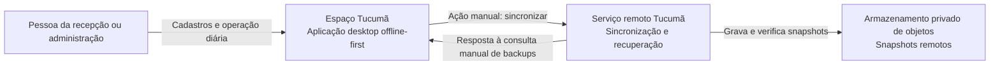
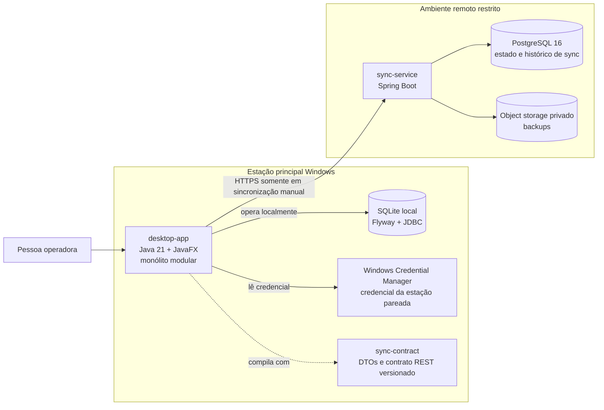
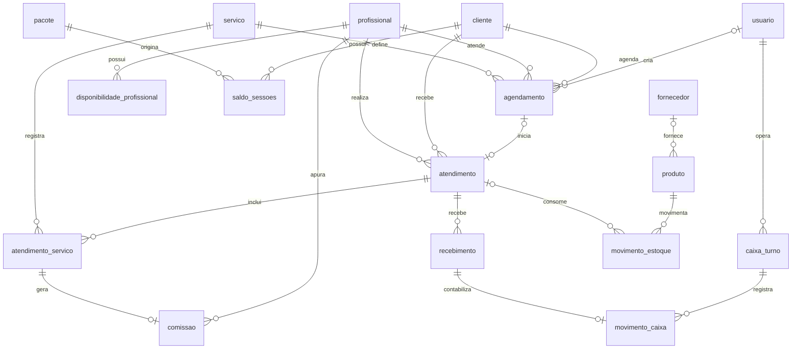
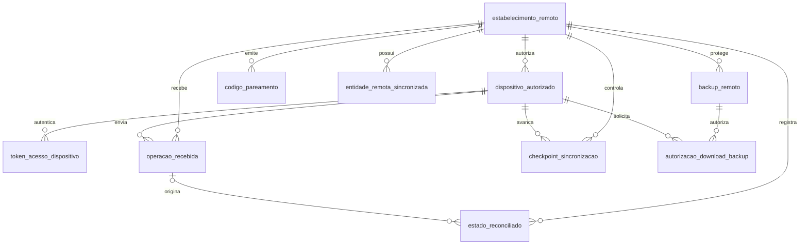
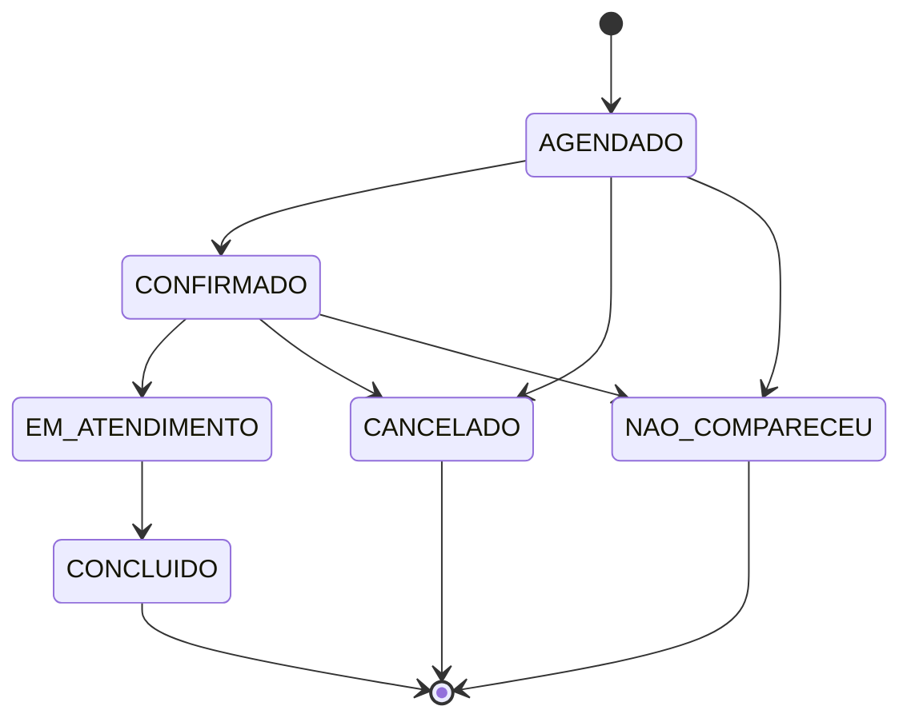

# Arquitetura e decisões técnicas

Esta página descreve a implementação e os trade-offs observáveis no código. **A especificação do produto continua sendo a única fonte normativa:** [Especificação Espaço Tucumã](ESPECIFICACAO_ESPACO_TUCUMA.md). As tabelas e estados abaixo refletem as migrações e os tipos atuais e podem evoluir com o código.

## 1. Contexto — C4 nível 1

Uma estação Windows executa o aplicativo principal e mantém a operação diária no banco SQLite local. O serviço remoto recebe operações somente quando uma pessoa inicia a sincronização. O provedor de objetos guarda os snapshots remotos; não participa da rotina offline.



## 2. Containers — C4 nível 2



`desktop-app` organiza o código pelos diretórios reais `ui`, `application`, `domain`, `infrastructure` e `integration`. A UI chama casos de uso de `application`; esses usam regras e tipos de `domain` e portas em `application.port`. Adaptadores de SQLite ficam em `infrastructure.sqlite`; o cliente HTTP fica em `infrastructure.synchronization`. `sync-contract` compartilha DTOs sem assumir a operação do negócio. `sync-service` não hospeda agenda, caixa ou cadastros operacionais.

O build Maven tem três módulos: `desktop-app`, `sync-contract` e `sync-service`. Não há implantação/publicação automática configurada pelo build. A aplicação instalada mantém banco, preferências e logs fora da pasta do programa. A raiz de dados pode ser configurada por perfil; a estação mantém um lock para impedir duas instâncias no mesmo banco.

## 3. Persistência e modelo relacional

O diagrama mostra os relacionamentos centrais do banco **local** `desktop-app/src/main/resources/db/migration`. Campos auxiliares, índices, tabelas de auditoria e tabelas de sincronização foram omitidos para facilitar a leitura; entidades e nomes estão escritos como nas migrações.



Regras de armazenamento relevantes:

- Identificadores de entidades são UUIDs estáveis. Instantes técnicos são persistidos em UTC; horários de agenda são apresentados no fuso local.
- Valores monetários nas tabelas locais são inteiros em centavos. Estoque pode usar milésimos da unidade (`*_milesimos`).
- Exclusões operacionais são restringidas quando há histórico relacionado; clientes, profissionais, serviços e produtos podem ser inativados.
- Recebimentos e movimentos têm chaves de idempotência; o vínculo único de `movimento_caixa.recebimento_id` impede duplicar o lançamento de um recebimento.
- `evento_auditoria` registra eventos operacionais; `operacao_pendente` registra a fila de saída. Outras tabelas de suporte locais incluem `cursor_alteracao_remota`, `alteracao_remota_recebida`, `reconciliacao_restaurada` e `ponto_recuperacao_aplicado`.

O serviço remoto mantém **outro banco**, PostgreSQL. A tabela `checkpoint_sincronizacao` também existe nos dois bancos, com chaves e função próprias: no remoto, acompanha sequências por estabelecimento e dispositivo; no SQLite, guarda o cursor local da estação.



`operacao_recebida` é o histórico de submissões e resultados; `entidade_remota_sincronizada` contém a versão remota vigente por entidade. `estado_reconciliado` preserva conflitos. `backup_remoto` guarda metadados e chave do objeto, enquanto o conteúdo fica no armazenamento privado. A autorização de download é temporária, vinculada a um backup e dispositivo e utilizável uma vez.

## 4. Estados do agendamento

As transições vêm de `AppointmentStatus.allowsTransitionTo` em `desktop-app/src/main/java/br/com/espacotucuma/desktop/application/scheduling/AppointmentStatus.java`.



Os estados finais não têm transições posteriores no enum. Reagendamento é uma operação administrativa permitida somente antes de iniciar o atendimento (`AGENDADO` ou `CONFIRMADO`); exceções de conflito de agenda exigem permissão e justificativa. A entidade `atendimento` tem seu próprio estado (`EM_ANDAMENTO`, `CONCLUIDO`, `CANCELADO`), não é sinônimo do estado do agendamento.

## 5. Escrita local e outbox

Cada alteração local ocorre dentro de `SqliteUnitOfWork.execute`. O caso de uso grava a entidade e, se ela for sincronizável, acrescenta a `operacao_pendente` na mesma transação SQLite. Uma falha antes do commit desfaz ambas. A outbox guarda UUID da operação, entidade/ID, tipo, chave idempotente, payload e versão esperada.

```mermaid
flowchart TD
    ui[Pessoa altera dados na UI]
    usecase[Caso de uso application]
    tx[Abrir transação SQLite]
    data[Gravar entidade e auditoria]
    outbox[Inserir operacao_pendente]
    commit[Commit local]
    offline[Sem conexão: permanece PENDENTE]
    click[Ação explícita: Sincronizar]
    server[Enviar lote ao serviço remoto]
    result{Resultado por operação}
    accepted[Confirmar como SINCRONIZADA\ncom versão remota]
    conflict[Preservar pendência e registrar conflito]
    changes[Receber alterações após checkpoint]
    reconcile[Aplicar alterações e cursor local\nna mesma transação]

    ui --> usecase --> tx --> data --> outbox --> commit
    commit --> offline
    commit --> click --> server --> result
    result -->|ACEITA| accepted
    result -->|CONFLITO ou REJEITADA| conflict
    accepted --> changes --> reconcile
```

O commit local não depende da rede. Somente a confirmação remota permite marcar uma operação como sincronizada. Se a resposta se perder, o cliente consulta `/sync/operations/status` antes de concluir a operação; repetir a mesma chave idempotente retorna o resultado original quando o conteúdo coincide. Reutilizar a chave com conteúdo diferente resulta em conflito. A alteração remota só avança quando a versão esperada corresponde à atual; conflito é preservado para revisão, não sobrescrito silenciosamente.

## 6. Contrato de sincronização

`SyncContract.VERSION` é atualmente `1`; as chamadas levam `X-Tucuma-Contract-Version`. Lotes têm no máximo 100 operações; consulta de estado aceita de 1 a 20 IDs e páginas de alterações até 100. Rotas implementadas:

| Método e rota | Uso |
| --- | --- |
| `POST /sync/admin/enrollments` | Administrador técnico gera código de pareamento de estação. |
| `POST /sync/admin/station-replacements` | Revoga estação anterior e prepara substituição autorizada. |
| `POST /sync/devices/pair` | Pareia uma estação com código de uso único e prazo curto. |
| `POST /sync/devices/token` | Emite token de acesso temporário para a estação autorizada. |
| `POST /sync/admin/devices/{deviceId}/revoke` | Revoga a estação. |
| `GET /sync/status` | Confere contrato, identidade e checkpoint remoto da estação. |
| `POST /sync/operations` | Submete operações locais. |
| `GET /sync/operations/status?ids=...` | Confirma resultados de operações após perda de resposta. |
| `GET /sync/changes?after=...&limit=...` | Lê alterações depois do checkpoint informado. |
| `POST /sync/backup` e `GET /sync/backups` | Solicita snapshot e lista somente pontos verificados. |
| `POST /sync/restore-request` e `GET /sync/restore-download` | Autoriza e entrega snapshot validado a cliente autorizado. |

O fluxo conectado em `HttpManualSynchronizationClient` verifica identidade/checkpoint, envia operações, confirma resultados, lê mudanças, reconcilia e atualiza o cursor local. Só solicita backup quando não há pendências ou conflitos que impeçam a confirmação; `BACKUP_VALIDATED` é distinto de `SYNCHRONIZED_NO_BACKUP`.

## 7. Snapshot, verificação e retenção

O serviço forma snapshot do estado remoto das entidades e reconciliações para um checkpoint. O armazenamento recebe o objeto; PostgreSQL guarda ID, checkpoint, chave, checksum SHA-256, versão de formato e situação. O serviço relê o objeto e valida checksum, formato, estabelecimento, checkpoint e manifesto antes de indicar `VALIDADO`. A consulta de backups verifica novamente o objeto e só lista os pontos íntegros.

Estados de `backup_remoto`: `PENDENTE`, `VALIDADO`, `FALHOU` e `EXPIRADO`. Resultados de verificação incluem `INTEGRO`, `CHECKSUM_INVALIDO`, `FORMATO_INVALIDO`, `OBJETO_AUSENTE`, `ERRO_STORAGE` e `REMOVIDO_RETENCAO`. Um erro temporário de storage é registrado, mas não é tratado como perda confirmada do backup. A manutenção agendada no serviço usa UTC, por padrão às 02:00. Retenção padrão: os 30 pontos íntegros mais recentes, cobertura de um ponto por dia nos últimos 90 dias e o ponto íntegro mais próximo anterior ao limite; valores podem ser configurados por ambiente. Só um objeto removido com sucesso recebe `EXPIRADO`.

## 8. Recuperação e limite de integração atual

O serviço protege os endpoints de restauração com autenticação da estação e autorização de download de uso único, vinculada ao backup/dispositivo e com expiração. O componente `LocalBackupRestorer` valida checksum, estabelecimento, ID e manifesto; limita o conteúdo a 64 MiB; exige confirmação explícita; recusa arquivo SQLite aberto; prepara e migra uma base temporária; aplica o snapshot e confere a base; preserva o banco anterior em cópia `*.pre-restore-*.sqlite`; então substitui o arquivo preparado. Falhas de preparação não substituem a base existente.

**Limite da versão atual:** o desktop não chama `/sync/restore-request` nem `/sync/restore-download` e não apresenta restauração remota na interface. O serviço e o componente local existem, mas o fluxo de ponta a ponta não está ligado ao cliente desktop. A pessoa operadora deve chamar suporte autorizado; esta página técnica não é um procedimento para executar chamadas REST manualmente. O teste `LocalBackupRestorerTest` exercita restauração em SQLite temporário, incluindo checksum/consentimento inválidos, compatibilidade e preservação da base anterior.

## 9. Segurança e decisões

- **Offline-first:** SQLite é a fonte operacional da estação; indisponibilidade de rede não bloqueia a recepção.
- **Uma estação ativa:** o serviço impede pareamento concorrente de mais de um dispositivo ativo por estabelecimento. Substituição revoga a credencial anterior.
- **Credenciais:** códigos de pareamento expiram em 30 minutos e são consumidos uma vez; tokens de estação duram 15 minutos. A credencial pareada é guardada pelo cliente no Windows Credential Manager. Não registrar segredos em logs, relatórios ou documentação.
- **Escopo remoto:** o serviço autentica estação e estabelecimento, limita requisições por dispositivo e restringe a política do storage ao bucket/recursos necessários. PostgreSQL e object storage não são a fonte de agenda/caixa do dia a dia.
- **Integridade:** FK SQLite está habilitada por conexão; versões esperadas, chaves de idempotência, transações e checkpoints reduzem duplicação e perda por retries. Pendências não somem com falha de rede.
- **Auditoria:** decisões locais de conflito preservam a representação remota e registram usuário, motivo e evento de auditoria.
- **Restauração assistida:** o serviço não considera sincronização equivalente a backup concluído; é necessário ponto remoto validado. Alterações desde esse checkpoint podem se perder numa falha total da estação.

Consulte [Segurança do serviço remoto](SEGURANCA_SERVICO_REMOTO.md) para implantação, configuração e resposta a incidentes. Para comandos e jornadas operacionais, use o [Manual operacional](MANUAL_OPERACIONAL.md) e [Backup e recuperação](RECUPERACAO_E_BACKUP.md).
