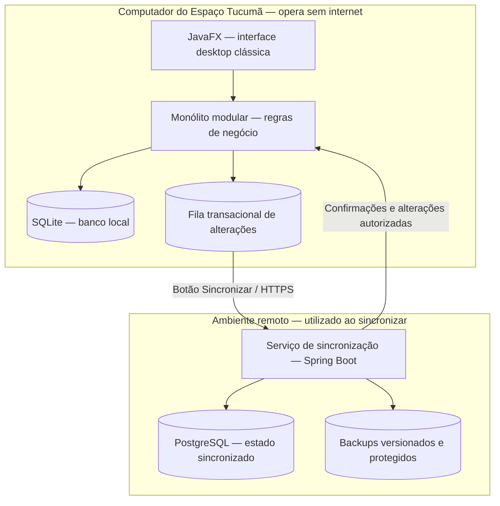

# Espaço Tucumã — Especificação do Sistema de Gestão

> **Tipo de documento:** fonte de verdade funcional, visual e arquitetural do produto.  
> **Estado:** proposta de projeto de portfólio, simulando uma encomenda freelancer para um pequeno negócio de beleza e estética em Manaus (AM).  
> **Natureza:** aplicação **desktop**, **offline-first**, com **sincronização manual** e **backup remoto**.  
> **Fora do escopo deste documento:** tarefas, sprints, cronograma, estimativas e instruções passo a passo de implementação.

## 1. Identidade e propósito

**Nome do estabelecimento fictício:** Espaço Tucumã.  
**Nome do sistema:** **Sistema de Gestão do Espaço Tucumã**.  
**Nome curto para a interface:** **Tucumã — Gestão**.

O sistema é uma solução sob medida para um pequeno estabelecimento de beleza e estética de Manaus. Deve parecer um software comercial efetivamente encomendado para a rotina da recepção, dos profissionais e da proprietária — **não** uma plataforma SaaS genérica, marketplace ou produto com múltiplos clientes/empresas.

O estabelecimento atende com uma equipe pequena e realiza serviços como manicure, pedicure, design de sobrancelhas, depilação, limpeza de pele e outros procedimentos **não médicos**. Sua operação envolve agendamentos, cadastro de clientes, serviços e pacotes, recebimentos, comissões, produtos de consumo e relatórios administrativos.

### Problema que resolve

O negócio usa caderno, mensagens e planilhas. A internet pode ser intermitente, e a proprietária talvez consiga conectar o computador apenas **uma ou duas vezes ao dia**. O software precisa continuar atendendo a operação durante todo o expediente **sem depender de internet**, com armazenamento persistente no computador e opção clara de sincronizar para um ambiente remoto quando a conexão estiver disponível.

### Princípios inegociáveis

1. **O trabalho diário é local:** abrir o programa, autenticar-se e operar o caixa, a agenda e os cadastros não dependem de servidor externo.
2. **Salvar não é sincronizar:** toda operação concluída é salva no banco local imediatamente; a sincronização ocorre somente por ação explícita da pessoa usuária.
3. **Sincronizar não pode apagar dados silenciosamente:** operações devem ser rastreáveis, reexecutáveis sem duplicação e seguras diante de falhas de rede.
4. **Dados remotos são uma proteção adicional:** o programa deve mostrar qual foi o último backup/sincronização bem-sucedido e esclarecer o que ainda está somente no computador.
5. **A interface deve privilegiar produtividade:** visual Classic Enterprise GUI (2005–2015), compacto, funcional, com tabelas, formulários e comandos evidentes.
6. **Simplicidade proporcional ao negócio:** uma instalação principal e um monólito local; sem microsserviços, assinatura de SaaS, app móvel ou serviços complexos desnecessários.

## 2. Público e ambiente de operação

| Perfil | Necessidade principal | Acesso esperado |
| --- | --- | --- |
| Proprietária / administradora | Gerir serviços, preços, equipe, caixa, relatórios e sincronização | Completo |
| Recepcionista | Cadastrar clientes, agendar, receber pagamentos e consultar agenda | Operacional, com restrições financeiras |
| Profissional | Consultar agenda própria, concluir serviços e conferir comissões | Restrito aos próprios atendimentos |

**Ambiente prioritário:** computador Windows 10/11 em recepção ou escritório, com teclado e mouse. A interface poderá funcionar em outros sistemas operacionais compatíveis com a stack, mas a distribuição e a experiência serão priorizadas para Windows. Resolução mínima-alvo: **1366 × 768**; melhor aproveitamento em Full HD.

**Topologia prevista:** **uma estação principal ativa** por estabelecimento, com várias contas locais para os colaboradores. O serviço remoto é utilizado para sincronização, backup e eventual recuperação. **Não existe edição concorrente por múltiplos computadores na primeira entrega.** Transferir a operação a outro computador exige processo controlado de restauração e troca da estação principal; não se deve anunciar colaboração multiestação offline.

## 3. Escopo funcional

### 3.1. Acesso, perfis e configurações

- Tela de login local, troca de senha e encerramento seguro da sessão.
- Contas por colaborador e perfis de permissões; operações financeiras sensíveis exigem autorização compatível.
- Configurações do estabelecimento: nome fantasia, dados exibidos em comprovantes, expediente, intervalos, parâmetros de comissões, moeda BRL e fuso **America/Manaus**.
- Bloqueio ou desativação de usuário sem apagar o histórico de suas operações.
- Configuração da conta de backup remoto e identificação da estação autorizada.

### 3.2. Clientes

- Cadastro, edição, consulta e inativação; identificação por código interno.
- Nome, telefone, contato opcional, preferências administrativas e histórico de atendimentos.
- Busca rápida e prevenção de cadastros duplicados por conferência, **sem** bloquear homônimos automaticamente.
- Registro de ausências, cancelamentos e observações operacionais não sensíveis.
- **Não armazenar no escopo inicial** prontuários, diagnósticos, fotos íntimas, histórico médico ou informações clínicas sensíveis.

### 3.3. Profissionais, serviços e preços

- Cadastro de profissionais com horários de trabalho e situação ativa/inativa.
- Catálogo de serviços: nome, categoria, duração padrão, preço, ativo/inativo e comissão configurável.
- Preço e percentual aplicados ao atendimento são registrados como **snapshot** no momento da confirmação do serviço; alterar a tabela depois não modifica o histórico.
- Pacotes pré-pagos de sessões, com quantidade contratada, saldo, validade e histórico de utilização.
- Serviços e produtos podem ser inativados, mas referências históricas permanecem íntegras.

### 3.4. Agenda

- Visualizações por dia/semana e por profissional, com filtros e horário de expediente.
- Criar, remarcar, cancelar, confirmar e concluir agendamentos.
- Estados: **Agendado → Confirmado → Em atendimento → Concluído**; **Cancelado** e **Não compareceu** como encerramentos alternativos.
- Impedir sobreposição de horários do mesmo profissional, considerando duração e intervalos bloqueados; o sistema deve informar o conflito antes de salvar.
- Permitir encaixes apenas se houver horário livre ou autorização administrativa para exceção explicitamente registrada.
- Agendamento não significa automaticamente receita recebida.

### 3.5. Atendimento, cobrança e comissão

- Ao concluir um atendimento, registrar o serviço realizado, profissional, valor efetivo, desconto autorizado, forma(s) de pagamento e situação de recebimento.
- Permitir pagamento único ou dividido entre dinheiro, Pix e cartão como **lançamentos administrativos**; não haverá integração direta com adquirentes nem processamento de cartão.
- Registrar estornos e cancelamentos financeiros por lançamentos de compensação, preservando rastreabilidade; não apagar lançamentos concluídos.
- Calcular comissão conforme a regra vigente registrada no atendimento; alterações posteriores nos percentuais não reescrevem comissões anteriores.
- Exibir resumo claro: total do serviço, desconto, total a pagar, valor recebido, saldo pendente e comissão.
- Emitir **comprovante interno não fiscal**, imprimível ou exportável em PDF; emissão de nota fiscal eletrônica fica fora do escopo.

**Exemplo ilustrativo de regra de negócio:** serviço de R$ 150,00, comissão de 30%, sem desconto: comissão de R$ 45,00. A diferença de R$ 105,00 representa receita antes de outros custos e despesas — **não** lucro líquido.

### 3.6. Caixa e financeiro

- Abertura e fechamento de caixa por operador e turno.
- Lançamentos de entradas, saídas, sangrias, suprimentos e despesas operacionais.
- Conciliação administrativa entre pagamentos registrados e valores conferidos no fechamento.
- Registro de motivo e responsável para ajuste, desconto excepcional, estorno e reabertura.
- Relatórios por período, origem, profissional, serviço e forma de pagamento.
- Regras de integridade para impedir recebimento duplicado na reexecução de um comando ou sincronização.

### 3.7. Estoque

- Cadastro de produtos de consumo e revenda, unidade, custo, preço opcional, estoque mínimo e fornecedor.
- Entradas, saídas, ajustes justificados e histórico por usuário.
- Consumo opcional por serviço, configurado por produto e quantidade, com baixa ao concluir atendimento.
- Alertas de estoque baixo; o estoque não pode ser alterado diretamente sem gerar movimentação.
- Quantidades e valores devem seguir precisão definida, evitando cálculos monetários com `float`/`double`.

### 3.8. Relatórios e exportações

- Agenda do dia, atendimento por profissional, clientes recorrentes e ausências.
- Faturamento e recebimentos por período, serviço, profissional e meio de pagamento.
- Comissões acumuladas, despesas, movimentações de caixa e saldo administrativo.
- Consumo de materiais, posição de estoque e itens abaixo do mínimo.
- Exportação CSV e PDF, com identificação do período, filtros e momento da geração.
- Todas as consultas e exportações devem funcionar **offline**, com base nos dados locais.

### 3.9. Auditoria

- Registrar criação, alteração, cancelamento, estorno, ajustes financeiros, alterações de permissões e eventos de sincronização.
- Guardar identificador de operação, usuário, data/hora, origem e referência do registro afetado.
- Não permitir edição manual de eventos de auditoria pela interface.

## 4. Interface: Classic Enterprise GUI (2005–2015)

O estilo visual deve remeter a sistemas administrativos Windows e ERPs de pequeno porte da época, mantendo boa legibilidade e acessibilidade contemporâneas.

### Estrutura

```text
┌──────────────────────────────────────────────────────────────────────────┐
│ Tucumã — Gestão                                      [ _ ][ □ ][ X ]   │
├──────────────────────────────────────────────────────────────────────────┤
│ Arquivo  Cadastros  Agenda  Movimentações  Relatórios  Ferramentas Ajuda │
├──────────────────────────────────────────────────────────────────────────┤
│ [Novo] [Editar] [Salvar] [Cancelar] [Excluir] [Imprimir] [Sincronizar]    │
├───────────────────┬──────────────────────────────────────────────────────┤
│ MÓDULOS           │ Clientes                                 [Pesquisar]│
│ ▸ Cadastros       │ ┌──────┬────────────────────┬───────────┬───────────┐│
│ ▸ Agenda          │ │Código│ Nome               │ Telefone  │ Situação  ││
│ ▸ Atendimento     │ ├──────┼────────────────────┼───────────┼───────────┤│
│ ▸ Caixa           │ │ 1024 │ Maria Oliveira     │ ...       │ Ativo     ││
│ ▸ Estoque         │ │ 1025 │ Ana Souza          │ ...       │ Ativo     ││
│ ▸ Relatórios      │ └──────┴────────────────────┴───────────┴───────────┘│
│ ▸ Administração   │ [Primeiro] [Anterior]  Página 1/12  [Próximo]      │
├───────────────────┴──────────────────────────────────────────────────────┤
│ Usuário: Recepção  |  Banco local: OK  |  Pendentes: 12  |  Última     │
│ sincronização: 08:14 de ontem                         [Sincronizar]      │
└──────────────────────────────────────────────────────────────────────────┘
```

### Diretrizes visuais e de interação

- Barra de menus no topo, barra de ferramentas com ícones e rótulos e navegação lateral por módulos.
- Paleta sóbria: cinzas, azul corporativo e branco; realce discreto para foco, seleção, erro e operação bem-sucedida.
- Tabelas compactas e densas; formulários em duas colunas quando apropriado, labels alinhadas, grupos e abas.
- Botões explícitos **Novo**, **Editar**, **Salvar**, **Cancelar**, **Excluir/Inativar**, **Imprimir**, **Exportar** e **Sincronizar**.
- Diálogos para operações secundárias e confirmações de ações sensíveis; evitar animações, gradientes decorativos, glassmorphism e cards grandes.
- Atalhos consistentes: `Ctrl+N` (novo), `Ctrl+S` (salvar), `Esc` (fechar/cancelar diálogo), `F5` (atualizar visão local); não capturar atalhos de forma inesperada.
- Pesquisa, navegação por teclado, estados de foco, contraste e mensagens de validação objetivas.
- A indicação de **offline** é informativa e **nunca bloqueia** o trabalho normal.

## 5. Comportamento offline e persistência local

- O sistema deve iniciar e autenticar usuários previamente cadastrados **sem internet**.
- O **SQLite local** é a base operacional e a fonte imediata de leitura/escrita durante o expediente.
- Cada ação de negócio deve gravar seus dados e, quando relevante para replicação, um registro durável na **fila de alterações pendentes** em **uma mesma transação local**.
- A confirmação visual de um cadastro, pagamento ou agendamento depende **somente** da confirmação da transação local, não do serviço remoto.
- Encerrar, reiniciar o computador ou sofrer uma queda de internet não deve fazer desaparecer transações locais já confirmadas.
- Falha de sincronização não deve bloquear a agenda, o caixa nem demais módulos, nem marcar como sincronizado o que não foi confirmado remotamente.
- A aplicação deve indicar **“Somente neste computador”** para alterações ainda não protegidas remotamente.
- O relógio local não deve determinar sozinho a ordem de conflitos; usar identificadores de operação, versões e sequência confirmada pelo servidor.

## 6. Sincronização manual e backup remoto

### 6.1. Intenção e terminologia

O botão **Sincronizar** envia alterações locais ainda pendentes, confere sua aceitação pelo servidor, consulta alterações remotas autorizadas e gera um **ponto de recuperação remoto consistente**. A sincronização também serve ao backup, mas os termos não são idênticos:

- **Salvamento local:** proteção imediata contra perda de informação durante a operação normal, dependente da integridade do equipamento local.
- **Sincronização:** reconciliação de estado entre banco local e remoto, com controle de versões e confirmação de operações.
- **Backup remoto:** cópia recuperável, versionada e protegida contra perda, corrupção ou exclusão acidental; precisa permitir restauração testável. Uma mera réplica atual **não** substitui pontos de recuperação históricos.

**Regra de produto:** o programa **não sincroniza automaticamente em segundo plano**; a pessoa usuária inicia a operação pelo botão. A interface pode avisar que está há muito tempo sem sincronizar, mas não deve tentar transferir dados sem pedido explícito.

### 6.2. Fluxo de sincronização

1. A pessoa autorizada clica em **Sincronizar**; o sistema informa a quantidade de alterações locais pendentes e inicia a operação.
2. O aplicativo verifica conectividade com o **serviço remoto próprio** e autentica a instalação autorizada. Ausência de rede não impede o uso local.
3. O cliente consulta a versão/checkpoint remoto e verifica se há alterações que exigem atualização ou tratamento de conflito.
4. Envia as operações locais pendentes **em lotes pequenos**, com identificadores únicos e chaves de idempotência; o servidor as valida e confirma **por operação ou lote atômico definido**.
5. O aplicativo marca como sincronizadas **apenas** operações cuja confirmação persistida no servidor foi recebida ou comprovada em nova consulta.
6. Obtém alterações remotas não presentes localmente, quando existirem, aplicando-as em transações locais com controle de versão. Na configuração de estação única, alterações inesperadas vindas de outra origem exigem verificação, nunca sobrescrita silenciosa.
7. Após a reconciliação sem pendências nem conflitos, o servidor gera/registra um **snapshot ou ponto de recuperação** correspondente ao estado confirmado, valida sua integridade e informa o identificador do backup.
8. A interface apresenta o resultado: horário da conclusão, itens enviados/recebidos, pendências restantes, checkpoint e estado do backup.

**A sincronização só é classificada como “Backup concluído” quando o ponto de recuperação remoto está confirmado.** Se os dados forem enviados, mas o snapshot falhar, a interface deve diferenciar **“Dados sincronizados; backup pendente”** de sucesso completo.

### 6.3. Interrupções, repetição e conflitos

| Cenário | Comportamento obrigatório |
| --- | --- |
| Sem conexão | Exibir mensagem clara; nenhuma alteração local é perdida; usuário pode tentar depois. |
| Queda durante envio | Manter itens não confirmados como pendentes; nova tentativa segura por idempotência. |
| Servidor confirmou, resposta se perdeu | Reconsultar operação pela chave única; **não** duplicar pagamento, estoque ou agendamento. |
| Queda durante recebimento | Aplicar somente lotes locais confirmados em transação; retomar do checkpoint íntegro. |
| Erro ou rejeição de registro | Informar registro e motivo; preservar alteração para análise, sem descartá-la. |
| Registro alterado em duas origens | Não usar “última gravação vence” automaticamente; bloquear o conflito e solicitar resolução autorizada. |
| Sincronização concluída, snapshot falhou | Manter indicação de sincronização concluída, mas **backup não concluído**. |
| Estação substituída | Exigir restauração supervisionada e vinculação da nova estação; impedir duas estações principais ativas. |

**Política de concorrência:** a primeira configuração autoriza **uma única estação operacional**. O serviço não aceita duas estações escrevendo simultaneamente no mesmo estabelecimento. O tratamento explícito de conflitos continua necessário para falhas operacionais, recuperação e eventos anômalos. Não há mesclagem automática de dados financeiros nem de movimento de estoque.

### 6.4. Retenção e restauração

- O servidor mantém **pontos de recuperação versionados**, com identificação de horário, origem, integridade e estado da geração.
- Política inicial proposta: preservar os **30 pontos mais recentes**, cobrindo **no mínimo 90 dias** quando existirem backups nesse intervalo. A política deve ser ajustável sem alterar regras de negócio.
- O aplicativo informa: **última sincronização concluída**, **último backup remoto validado**, **quantidade de pendências** e **tempo decorrido desde o último backup**.
- Recuperação em máquina nova ou após falha de hardware requer autenticação, autorização administrativa e identificação do ponto de recuperação desejado.
- Restaurar nunca deve sobrescrever silenciosamente dados locais mais recentes. Havendo dados locais, exigir exportação de segurança e confirmação explícita antes da substituição.
- O mecanismo deve verificar checksum/integridade do backup **antes** de declarar a recuperação bem-sucedida.
- A documentação operacional deverá instruir como recuperar a operação se o computador for perdido, roubado ou danificado.

**Limite explícito de proteção:** se a última sincronização ocorreu pela manhã e o computador for perdido à noite, alterações efetuadas após a última sincronização **podem ser irrecuperáveis**. A interface deve comunicar isso com clareza, sem prometer backup em tempo real.

## 7. Arquitetura proposta

### 7.1. Monólito desktop com componente remoto restrito

O **produto principal** é uma única aplicação desktop modular, instalada localmente, contendo a interface, as regras de negócio, as validações e o acesso ao banco. O serviço remoto **não é outro sistema de operação diária**: existe para autenticar o dispositivo, receber/enviar alterações, manter estado de recuperação e preservar backups.



### 7.2. Tecnologias de referência

| Responsabilidade | Tecnologia proposta | Justificativa |
| --- | --- | --- |
| Aplicação desktop | **Java 21 + JavaFX 21** | Interface desktop tradicional, empacotável e multiplataforma no núcleo. |
| Arquitetura local | **Monólito modular em camadas** | Baixa complexidade operacional e separação das regras por domínio. |
| Persistência operacional | **SQLite 3 + JDBC** | Banco embarcado, transacional e independente de conectividade. |
| Migrações locais | **Flyway** | Versionamento seguro do esquema local. |
| Serviço remoto | **Java 21 + Spring Boot 3** | API pequena, centralizando validação de sincronização e autenticação. |
| Persistência remota | **PostgreSQL 16** | Estado sincronizado, checkpoints e metadados de auditoria. |
| Armazenamento dos backups | **Object storage privado** | Snapshots versionados, criptografados e recuperáveis. |
| Transporte | **HTTPS + API REST JSON** | Comunicação autenticada apenas quando houver conexão. |
| Testes | **JUnit 5 + TestFX** | Regras de negócio, persistência e fluxos de interface desktop. |
| Empacotamento | **jpackage** | Instalador Windows com runtime integrado. |
| Build e versionamento | **Maven + Git** | Reprodutibilidade, histórico e manutenção. |

**Escolhas conscientes:** JavaFX substitui React/Thymeleaf porque o produto é **desktop**, não uma página web disfarçada. SQLite é o armazenamento principal porque o uso é **offline**. PostgreSQL e o serviço remoto não são necessários para abrir o sistema, apenas para a sincronização/restauração.

### 7.3. Organização por domínios internos

```text
br.com.espacotucuma
├── desktop             # inicialização, telas JavaFX, navegação e recursos visuais
├── shared              # tipos comuns, validações e tratamento de erros
├── security            # autenticação local, sessão e permissões
├── customers           # clientes e histórico
├── professionals       # colaboradores, horários e comissões
├── services            # catálogo e pacotes
├── scheduling          # agenda e conflitos
├── attendance          # atendimentos e estados
├── finance             # recebimentos, caixa e estornos
├── inventory           # produtos e movimentações
├── reporting           # consultas, impressão e exportações
├── auditing            # trilhas de auditoria
├── synchronization     # outbox, checkpoints, idempotência e restauração
└── infrastructure      # SQLite, migrações, integração HTTP e configurações
```

A separação acima é **lógica**: todas essas áreas são executadas dentro do mesmo aplicativo desktop, com um banco operacional local. Não são microsserviços nem projetos implantados separadamente.

## 8. Modelo de dados conceitual

Entidades principais e seus vínculos:

- `usuario`, `perfil`, `permissao` — acesso e auditoria.
- `cliente` — identificação, contatos e estado cadastral.
- `profissional`, `disponibilidade_profissional` — equipe e agenda.
- `servico`, `pacote`, `saldo_sessoes` — catálogo e pacotes.
- `agendamento`, `atendimento`, `atendimento_servico` — operação diária.
- `recebimento`, `recebimento_parcela`, `movimento_caixa`, `fechamento_caixa` — financeiro.
- `comissao` — regra efetivamente aplicada em um atendimento.
- `produto`, `fornecedor`, `movimento_estoque`, `consumo_servico` — materiais.
- `evento_auditoria` — trilha imutável de alterações relevantes.
- `operacao_pendente`, `checkpoint_sincronizacao`, `dispositivo_autorizado`, `backup_remoto` — resiliência e recuperação.

### Regras transversais de modelagem

- Identificadores estáveis do tipo **UUID** para entidades sincronizáveis, gerados localmente; códigos sequenciais de exibição, se necessários, não são chaves de sincronização.
- Campos técnicos para versão de registro, criação, alteração, autor e estado de exclusão lógica quando aplicável.
- Valores financeiros em `BigDecimal`/tipo decimal persistido com escala controlada; nunca `float`/`double` para dinheiro.
- Exclusão lógica para dados com dependências históricas; eventos financeiros confirmados são compensados por lançamentos, não apagados.
- Toda gravação relevante ao servidor produz evento/outbox na mesma transação local.
- Operações remotas têm **idempotency key** única, origem e versão esperada; servidor armazena resultado para retorná-lo em nova tentativa.
- A auditoria e os estados dos recebimentos precisam sobreviver a sincronização, restauração e migrações de versão.

## 9. Contrato funcional mínimo da sincronização

**Contrato conceitual**, não uma lista de endpoints definitiva:

- `GET /sync/status` — identidade da instalação, checkpoint remoto e situação do serviço.
- `POST /sync/operations` — envio em lote de operações locais identificadas, versionadas e idempotentes.
- `GET /sync/changes?after=...` — consulta incremental de alterações autorizadas após checkpoint.
- `POST /sync/backup` — confirmação/geração de ponto de recuperação para estado já sincronizado.
- `GET /sync/backups` — lista de pontos disponíveis para a instalação autorizada.
- `POST /sync/restore-request` — pedido autenticado de restauração e emissão de autorização de download temporária.

Requisitos gerais da API:

- Autenticar estabelecimento e dispositivo autorizado; aplicar autorização por operação.
- Proteger a comunicação com TLS, validar conteúdo e limitar tamanho de lotes.
- Confirmar somente gravações realmente persistidas.
- Repetições da mesma operação devem devolver o mesmo resultado e **nunca** reaplicar efeitos financeiros.
- Checkpoints não devem avançar diante de lote incompleto ou falha de persistência.
- Respostas devem distinguir erro temporário, rejeição por validação, credenciais inválidas e conflito de versão.
- O servidor não pode exigir conexão permanente, sessão de navegador ou endereço IP estático do cliente.

## 10. Segurança e privacidade

- Autenticação local offline com senhas armazenadas por hash resistente a ataques offline (**Argon2id** ou equivalente), nunca texto puro.
- Proteção de credenciais remotas no armazenamento seguro do sistema operacional; não incluí-las em repositório, arquivo `.env` distribuído ou log.
- Permissões por perfil aplicadas **nas regras de negócio**, não somente escondendo botões na tela.
- Backups remotos **criptografados em trânsito e em repouso**, com acesso restrito ao estabelecimento; chaves e política de recuperação documentadas.
- Recomendar proteção do disco local (por exemplo, criptografia de dispositivo/BitLocker) e controle de contas no Windows; avaliar criptografia do banco local conforme requisitos e restrições de distribuição.
- Registros de auditoria de operações financeiras, login, alteração de permissões, sincronização e restauração.
- Coleta mínima de dados pessoais, finalidade definida, controles de acesso e procedimentos de retenção/exclusão compatíveis com a **LGPD**.
- Não registrar dados sensíveis de saúde na modelagem inicial. Se o escopo mudar para prontuários/procedimentos clínicos, exigir avaliação específica de privacidade e segurança antes da implementação.
- Operações de exportação e restauração acessíveis somente a perfis autorizados; credenciais não devem aparecer em relatórios.

## 11. Requisitos não funcionais e critérios de aceitação do produto

| Dimensão | Comportamento verificável esperado |
| --- | --- |
| Operação offline | Login local, agenda, cadastros, atendimentos, caixa, estoque e relatórios funcionam sem internet. |
| Persistência | Reiniciar aplicativo/computador não remove operações locais já confirmadas. |
| Clareza de estados | Barra inferior mostra banco local, pendências, última sincronização e último backup validado. |
| Controle da rede | Só o clique explícito em **Sincronizar** inicia envio/recebimento de dados. |
| Falhas de conexão | Uma sincronização interrompida pode ser tentada novamente sem perda nem duplicação de movimentos. |
| Integridade financeira | Pagamento, estorno, comissão e baixa de estoque não são aplicados duas vezes. |
| Recuperação | É possível instalar em computador novo e restaurar ponto remoto íntegro mediante autorização. |
| Operação multiusuário local | Perfis diferentes usam a **mesma estação** e respeitam permissões; ações são auditadas. |
| Agenda | O programa bloqueia agendamentos simultâneos para o mesmo profissional, salvo exceção controlada. |
| Interface | Navegação por mouse e teclado, formulários compactos e tabelas legíveis em 1366 × 768. |
| Empacotamento | Instalador desktop opera sem exigir que o cliente configure Java, Docker ou banco externo manualmente. |
| Relatórios | Os relatórios são gerados pelo banco local, independentemente de conexão. |
| Qualidade | Regras críticas possuem testes automatizados e cenários verificáveis de falha/retentativa. |

## 12. Limites explícitos de escopo

O produto **não** é:

- Aplicação web, PWA ou Electron acessado por navegador.
- SaaS multiempresa/multitenant, sistema genérico vendido por assinatura ou marketplace de agendamentos.
- Conjunto de microsserviços, sistema de mensageria ou plataforma distribuída complexa.
- Aplicação que exige conexão contínua para abrir, autenticar ou registrar vendas.
- Sistema com sincronização silenciosa e automática a cada edição.
- Solução de edição simultânea por diversos computadores desconectados.
- Integração de emissão de NF-e/NFS-e, TEF, processadora de cartão, Pix bancário ou faturamento fiscal homologado.
- Prontuário clínico, sistema de diagnóstico, armazenamento de informações médicas ou sistema de pagamentos de saúde.
- Aplicativo para clientes finais, chatbot ou agendamento público online.
- Projeto que inclua IA apenas como elemento decorativo.

## 13. Documentação e demonstração como portfólio

O projeto deve ser apresentado de forma **honesta** como um **caso fictício de encomenda freelancer**, realizado para demonstrar desenvolvimento de software sob medida. Não afirmar contrato, faturamento, depoimento ou implantação real em cliente sem que isso tenha ocorrido.

A demonstração deve permitir observar:

- Ambiente desktop com identidade visual do **Espaço Tucumã** e dados sintéticos coerentes.
- Jornada de agendamento → atendimento → recebimento → comissão → relatório.
- Operação completamente offline, inclusive depois de reiniciar o aplicativo.
- Registros pendentes aparecendo claramente na barra de status.
- Clique em **Sincronizar** com conexão disponível, confirmação remota e ponto de recuperação identificado.
- Queda deliberada de rede seguida de nova tentativa, sem duplicar dados.
- Procedimento demonstrável de restauração de backup para uma instalação de teste.

**Descrição curta para currículo, somente após existir uma implementação demonstrável:**

> **Espaço Tucumã — Gestão para Beleza e Estética:** aplicação desktop offline-first em JavaFX, Java e SQLite, com módulos de agenda, atendimento, caixa, comissões e estoque; sincronização manual, backup remoto versionado e arquitetura monolítica modular.

## 14. Decisões consolidadas e governança deste documento

As definições abaixo prevalecem em decisões futuras sobre o projeto, salvo alteração explícita registrada nesta especificação:

| Tema | Decisão vigente |
| --- | --- |
| Marca/caso | Espaço Tucumã, estabelecimento fictício de beleza e estética em Manaus |
| Formato | Aplicação **desktop** instalada no computador |
| Visual | **Classic Enterprise GUI, 2005–2015** |
| Arquitetura principal | **Monólito modular local** |
| Linguagem e UI | **Java 21 + JavaFX** |
| Banco operacional | **SQLite local**, independente de internet |
| Rede | **Manual**, somente por botão **Sincronizar** |
| Objetivo da sincronização | Transferir operações, verificar consistência e gerar **backup remoto recuperável** |
| Infraestrutura remota | Serviço limitado de sincronização/recuperação, PostgreSQL e storage privado de backups |
| Multiestação | **Fora do escopo**; uma estação principal autorizada |
| Privacidade | Minimização de dados, sem informações clínicas sensíveis |
| Escopo editorial | **Especificação do produto**; não é backlog de tarefas |

Qualquer documentação técnica, implementação, decisão de interface ou descrição pública do projeto deve ser compatível com este arquivo. Divergências relevantes devem ser resolvidas **atualizando explicitamente a decisão aqui**, em vez de introduzir comportamentos contraditórios em outros documentos.
