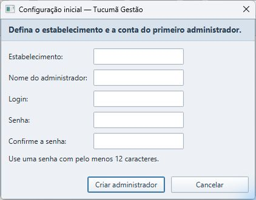
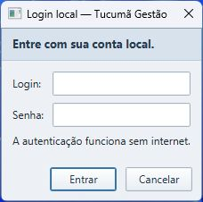
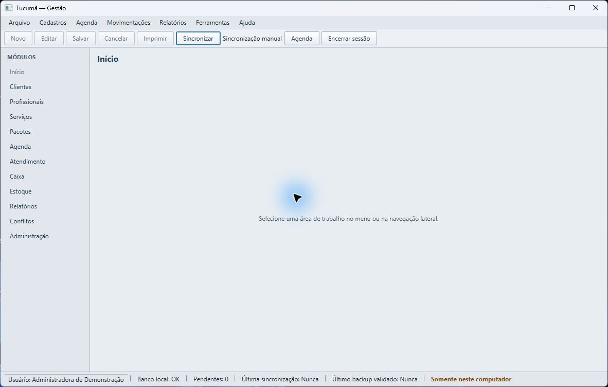
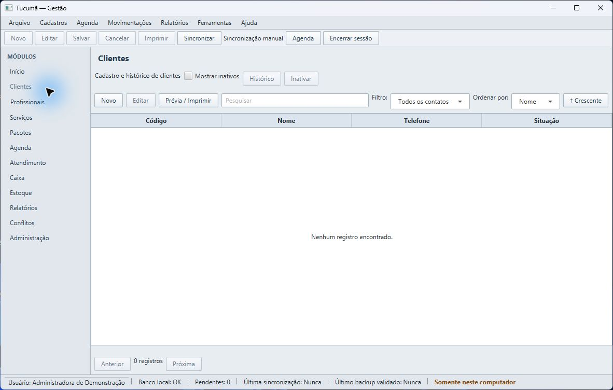
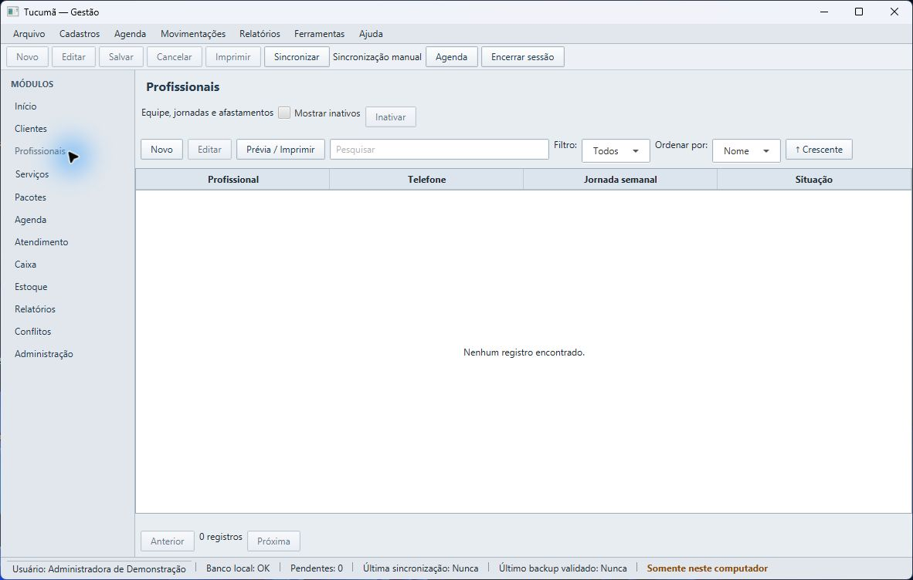
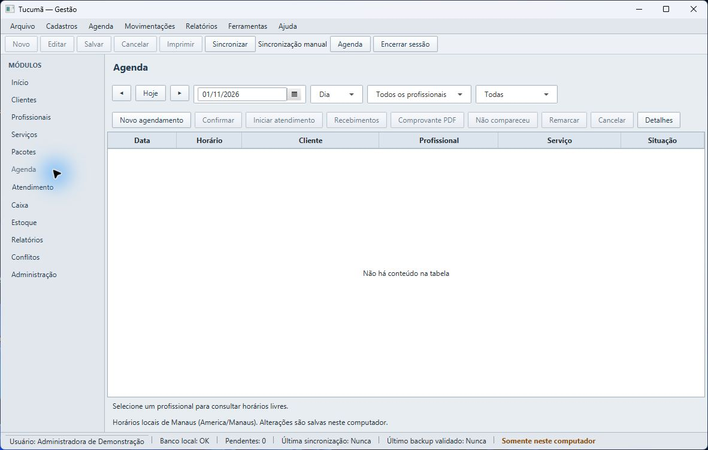
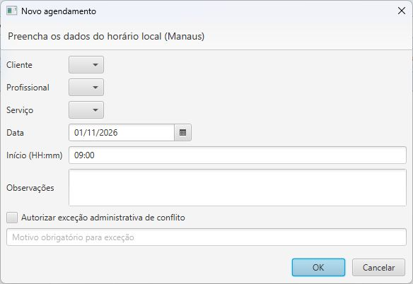
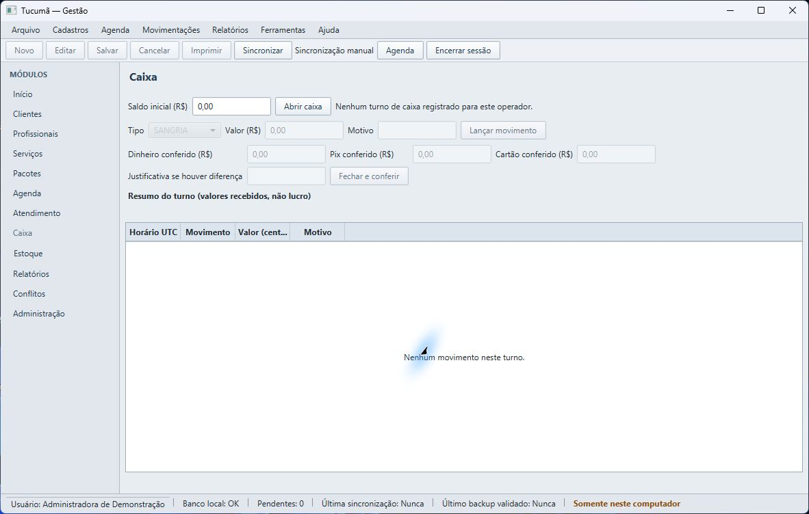
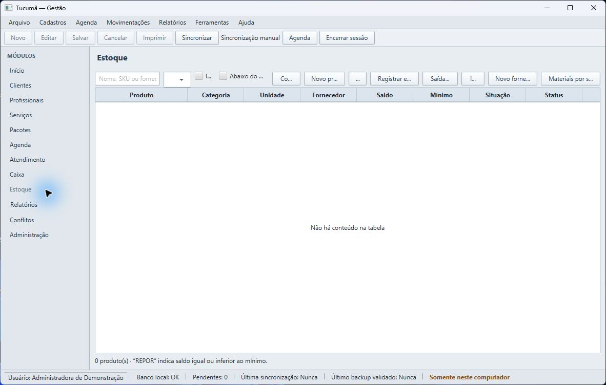
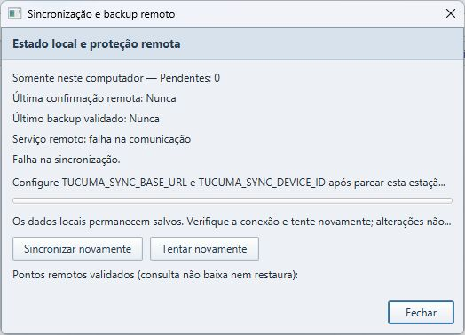

# Manual operacional — Espaço Tucumã

Este guia descreve o uso diário do aplicativo Windows. As telas podem variar um pouco entre versões. Os nomes entre aspas são os rótulos exibidos no programa.

## 1. Instalar e abrir

Siga [Instalação Windows](INSTALACAO_WINDOWS.md) para obter e instalar o MSI distribuído pela equipe responsável. Na estação da recepção, abra **Espaço Tucumã** pelo atalho do menu Iniciar ou da área de trabalho. A instalação não exige conexão com a internet para o uso local.

Os dados ficam fora da pasta do aplicativo, no perfil do usuário Windows. Não apague nem mova a pasta `.espacotucuma`: ela contém o banco local. A desinstalação normal preserva esses dados.

## 2. Primeiro acesso e entrada

Na primeira abertura de um banco novo, aparece **Configuração inicial**. Informe o estabelecimento, nome da pessoa administradora, login e senha. A senha deve ter pelo menos 12 caracteres; confirme-a e selecione **Criar administrador**. Guarde a senha em local protegido. A configuração é feita uma vez para aquele banco.

Depois, entre com o login e a senha locais. O login funciona sem internet. Use **Sair** ao encerrar o turno e não compartilhe a conta de outra pessoa.

Após entrar, confira a barra inferior: **Banco local: OK**, pendências, última sincronização, último backup validado e a indicação **Somente neste computador**. “Nunca” em última sincronização ou backup significa que ainda não há registro confirmado daquele processo.

## 3. Cadastros

Os dados são gravados no computador. Enquanto estiver sem internet, cadastros e consultas locais continuam disponíveis.

### Clientes

Abra **Clientes** e selecione **Novo**. O nome é obrigatório; telefone e contato são opcionais. Use preferências somente para observações administrativas pertinentes. Não registre diagnósticos ou dados clínicos neste campo. Se aparecer um aviso de possível duplicidade, confira o cadastro antes de confirmar. Para localizar um cliente, pesquise por nome ou telefone. **Inativar** preserva o histórico; use **Mostrar inativos** para consultá-lo.

Exemplo fictício: `Cliente Exemplo`. Não use dados reais em treinamento.

### Profissionais e serviços

Em **Profissionais**, selecione **Novo** e preencha os dados solicitados. Configure dias e períodos de atendimento quando aplicável; ausências e horários ajudam a evitar conflitos na agenda. Para consultar ou ajustar comissões, use somente o perfil autorizado.

Em **Serviços**, selecione **Novo**, informe nome, duração e preço conforme os campos da tela. Confira o valor e a duração antes de salvar. Para corrigir um item existente, selecione-o e use **Editar**. A inativação mantém o histórico.

## 4. Agenda e atendimento

Abra **Agenda**. Escolha o dia, **Hoje** ou a visão de dia/semana e, se necessário, filtre por profissional ou situação. Para marcar um horário, selecione **Novo agendamento** e informe cliente, profissional, serviço, data e hora. As observações devem ser administrativas e objetivas.

O sistema avisa sobre conflitos de horário. Uma exceção administrativa exige justificativa; use-a apenas se tiver autorização e após conferir os horários envolvidos.

Na linha do agendamento selecionado, as ações disponíveis incluem iniciar atendimento, recebimentos, comprovante, registrar falta, remarcar ou cancelar. Use **Não compareceu** somente quando a pessoa não tiver vindo; para mudar um horário, use **Remarcar**. Confira a seleção e os valores antes de registrar recebimentos. Agendar ou concluir um serviço, por si só, não significa que houve pagamento.

## 5. Caixa e fechamento do turno

Abra **Caixa** e confira se já existe um turno aberto para você. Para iniciar o turno, informe **Saldo inicial (R$)** e selecione **Abrir caixa**. Registre cada entrada ou saída em **Lançar movimento**, escolhendo o tipo, valor e motivo. Recebimentos registrados em um atendimento também aparecem no caixa; evite lançá-los novamente.

No fim do turno, conte separadamente dinheiro, Pix e cartão. Preencha os valores contados em cada campo. Se houver diferença, escreva uma justificativa. Confira os totais e selecione **Fechar e conferir**. O resumo do turno representa valores recebidos; não é cálculo de lucro. Reabertura ou estorno pode exigir perfil autorizado.

## 6. Estoque

Abra **Estoque**. Em **Novo produto**, informe nome, unidade, custo, estoque mínimo e, se houver, categoria, SKU, preço de venda e fornecedor. O fornecedor pode ser cadastrado em **Novo fornecedor**. Pesquise pelo nome, SKU ou fornecedor e selecione **Consultar**.

Para aumentar o saldo após uma compra, selecione o produto na tabela e escolha **Registrar entrada**. Para consumo ou correção, use **Saída/ajuste**, selecione o tipo, informe quantidade e motivo. Confirme antes de registrar: cada movimentação altera o saldo e fica no histórico. **REPOR** indica saldo igual ou abaixo do mínimo. Inativar um produto não apaga seus movimentos.

Se a operação usar consumo de material por serviço, configure **Materiais por serviço** com a quantidade por atendimento. Confira a unidade do produto. Essa configuração não substitui a conferência física do estoque.

## 7. Encerrar o dia

Antes de sair:

1. Confira os agendamentos do dia e registre faltas, remarcações e cancelamentos corretos.
2. Confira os recebimentos e pendências; não repita lançamentos já registrados no atendimento.
3. Feche seu turno de caixa com os valores contados e justifique divergências.
4. Confira as entradas, saídas e alertas de reposição do estoque.
5. Se houver estação remota pareada e conexão, faça a sincronização manual descrita abaixo e aguarde o resultado. Confirme também que o horário do último backup validado foi atualizado.
6. Selecione **Sair** e feche o aplicativo.

## 8. Sincronização manual e funcionamento sem internet

O uso local não depende de internet. A sincronização começa somente quando alguém seleciona **Sincronizar**. Não é executada automaticamente em segundo plano. Aguarde o resultado; se houver falha, os dados locais continuam gravados e as alterações não confirmadas permanecem pendentes. Não tente resolver apagando o banco ou repetindo lançamentos financeiros.

A estação precisa estar pareada e configurada previamente pela equipe técnica. A configuração de conexão e credenciais não deve ser feita por tentativa na recepção nem compartilhada por mensagem. Se aparecer aviso de configuração, falha de conexão ou pendências sem confirmação, anote o horário e contate o suporte autorizado.

**Sincronização não é sinônimo de backup.** Consulte na barra inferior o campo **Último backup validado**. Na janela de sincronização, **Consultar backups disponíveis** somente lista pontos remotos; não baixa nem restaura dados.

## 9. Perda do computador e recuperação

Em caso de falha total do computador, alterações feitas depois do último ponto de backup remoto validado podem se perder. Uma sincronização bem-sucedida, sem confirmação de backup validado, não elimina esse risco. Consulte [Backup e recuperação](RECUPERACAO_E_BACKUP.md) antes de trocar de computador ou reinstalar.
