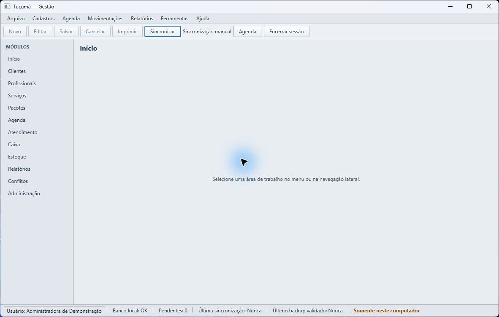

# Backup e recuperação — Espaço Tucumã

## O que a recepção precisa saber

- O banco principal fica no computador e continua sendo usado sem internet.
- **Sincronizar** envia alterações ao serviço remoto quando alguém inicia a ação. Isso, por si só, não confirma um backup recuperável.
- O aplicativo mostra **Último backup validado** depois que o serviço confirma um ponto de recuperação válido. Consulte essa data na barra inferior.
- Se o computador falhar completamente, alterações posteriores ao último backup validado podem se perder. Quanto maior o intervalo entre pontos validados, maior pode ser a quantidade de trabalho perdida.
- **Consultar backups disponíveis** apenas mostra a lista remota. A consulta não baixa, substitui nem recupera o banco local.

## Antes de uma falha

1. Ao fim do turno, use **Sincronizar** quando a estação estiver pareada e a conexão disponível.
2. Aguarde a confirmação e confira se **Último backup validado** mostra uma data recente.
3. Se a sincronização falhar ou o campo continuar antigo, anote a hora, a mensagem apresentada e a quantidade de pendências. Avise o suporte autorizado.
4. Não apague, reinstale ou copie por cima da pasta de dados como tentativa de correção.

## Se o computador não iniciar ou o banco local estiver indisponível

Na versão atual, não há comando para baixar e restaurar um backup remoto pela tela do aplicativo. A listagem de backups é somente consulta. Portanto, a pessoa operadora deve acionar o suporte autorizado para avaliar e executar uma recuperação a partir de um ponto remoto validado.

Ao solicitar ajuda, informe o nome do estabelecimento, identificação da estação se conhecida, versão do Windows, quando o problema começou e o horário aproximado do último backup validado. Não envie senhas, tokens, banco de dados ou dados de clientes por e-mail ou mensagem.

Até receber orientação, mantenha a estação desligada se ela apresentar falha de disco ou corrupção; evite novas instalações, redefinições e operações que possam sobrescrever arquivos. O suporte deve preservar uma cópia dos dados existentes antes de qualquer recuperação e confirmar com a pessoa responsável qual ponto validado deve ser utilizado. Depois da restauração, confira cadastros, agenda, caixa e estoque antes de retomar o atendimento. Registre manualmente operações feitas durante a indisponibilidade para reconciliá-las com cuidado, evitando pagamentos ou movimentos duplicados.

## Recuperação local técnica

O componente local de restauração valida o snapshot e o banco, prepara o arquivo temporário e preserva a base substituída com uma cópia `pre-restore`. Esse fluxo é destinado à equipe técnica e não é acionado pelo manual do operador nem por um botão do aplicativo. A equipe deve seguir o procedimento de suporte aprovado para a versão instalada, testar a cópia preservada e verificar os saldos e históricos antes de liberar a estação.

O teste automatizado `LocalBackupRestorerTest` valida a restauração em banco temporário e confirma que a base anterior fica preservada. Isso é evidência de validação técnica, não uma ferramenta de autoatendimento disponível à recepção.

## Prevenção e rotina

Mantenha o computador protegido contra desligamentos bruscos, espaço insuficiente e acesso não autorizado. Preserve a pasta de dados local e coordene com o suporte autorizado qualquer cópia de segurança adicional. Não trate cópia manual de arquivos SQLite enquanto o aplicativo está aberto como backup validado.

Se não houver acesso ao último horário de backup, considere que as alterações mais recentes podem não ter cópia remota confirmada e informe essa incerteza ao suporte.
